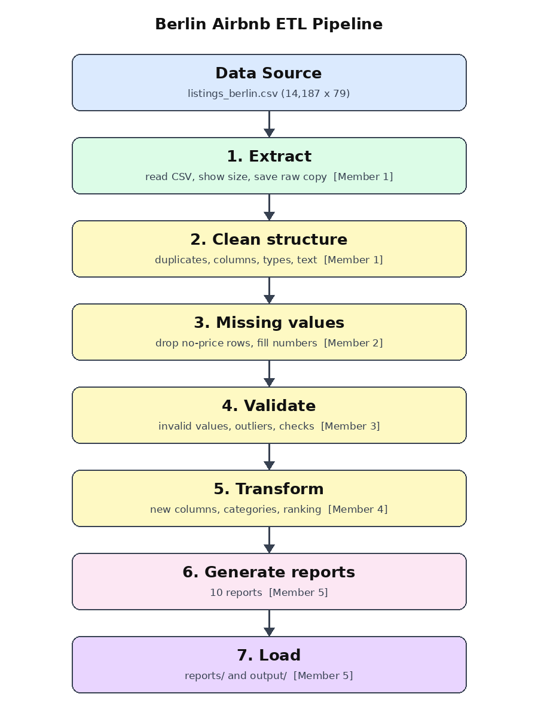
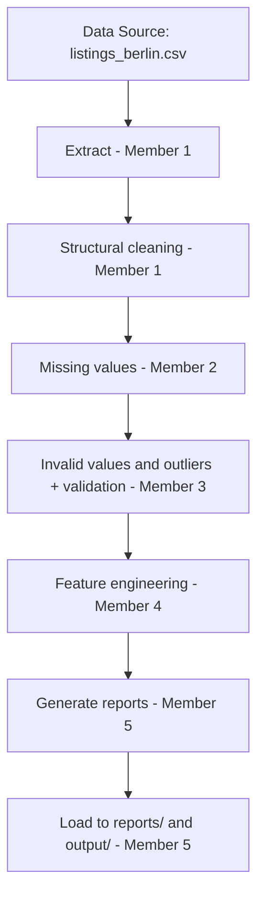

# Architecture

## Pipeline flow (Step 3)

## Who owns what
| Member | File | Pipeline step | Transformations |
|---|---|---|---|
| 1 (lead) | `etl/member1_extract_and_structure.py` | Extract + clean structure | T1 duplicates, T2 columns, T3 data types, T4 text |
| 2 | `etl/member2_missing_values.py` | Missing values | T5 |
| 3 | `etl/member3_invalid_and_outliers.py` | Invalid values, outliers, validation | T6, T7, validation checks |
| 4 | `etl/member4_features.py` | Feature engineering | T8 - T14 |
| 5 | `etl/member5_reports_and_load.py` | Reports and Load | 10 reports, `load()` |
| Lead | `pipeline.py`, `etl/config.py`, `etl/common.py`, `check_member.py`, tests, docs | Wiring | - |

## How the pieces connect
`pipeline.py` defines `extract()`, `transform()`, `generate_reports()`, `load()` and
`run_etl_pipeline()`. Each one calls the member modules in order. Every stage takes a pandas
DataFrame and returns a DataFrame, so a member only needs to respect that input and output.

| After stage | Rows | Columns |
|---|---|---|
| Raw file | 14,187 | 79 |
| Member 1 | 14,187 | 32 |
| Member 2 | 9,183 | 32 |
| Member 3 | 9,133 | 32 |
| Member 4 | 9,133 | 42 |

## Placeholders and CI
Until a member merges, their file is a placeholder with `IS_STUB = True`. Tests for a stage are
skipped (not failed) while it or an earlier stage is still a placeholder, so CI is green at every
step. Merging a real file removes `IS_STUB` and its tests start running automatically.
